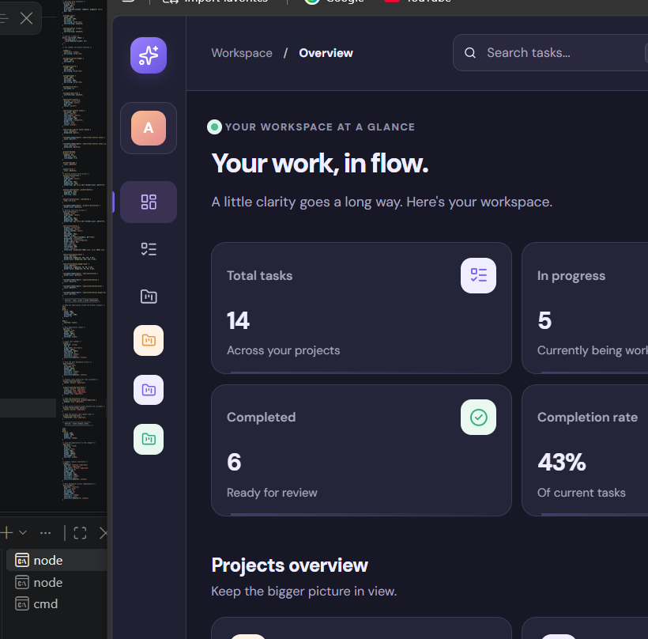
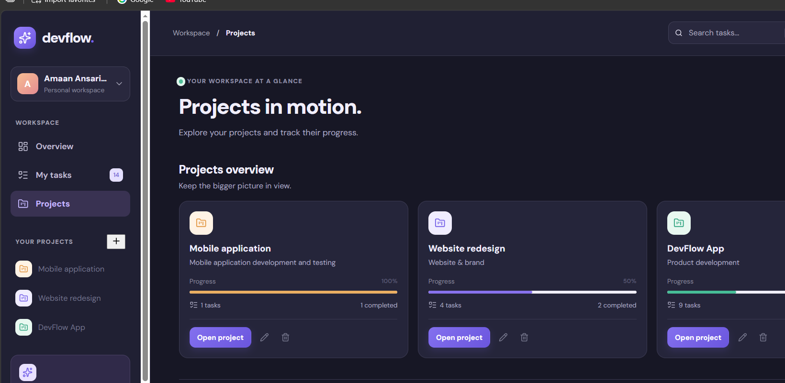
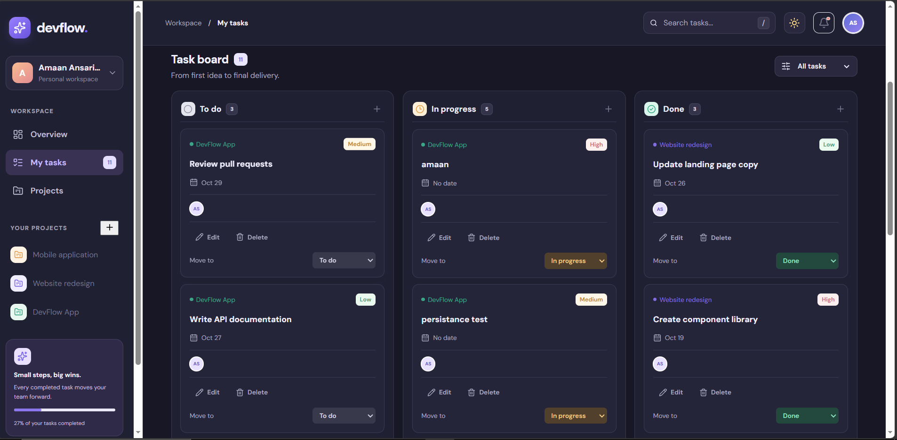
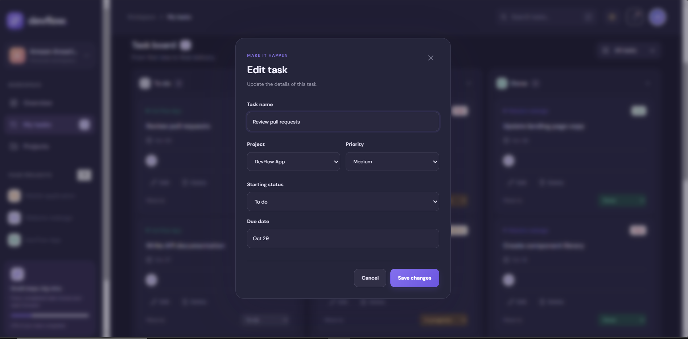

# DevFlow — Project & Task Management Workspace

DevFlow is a full-stack project and task management application built to help users organise projects, manage tasks, and track work from one dashboard.

[](https://github.com/amaanansari007/DevFlow)

> **Live demo:** Deployment is in progress. The public application link will be added here after the Vercel deployment has been completed and tested.

## Screenshots

### Dashboard



### Projects overview



### Task board



### Edit task



## Features

- **Authentication:** Register, log in, restore an existing session, and log out.
- **Project management:** Create, view, edit, and delete projects.
- **Task management:** Create, view, edit, and delete tasks.
- **Task workflow:** Move tasks between To do, In progress, and Done.
- **Task details:** Manage the project, priority, and due date for each task.
- **Dashboard metrics:** View total tasks, in-progress tasks, completed tasks, completion rate, and project progress.
- **Search and filtering:** Search tasks and filter them by status.
- **Workspace preferences:** Switch between light and dark themes.
- **Persistent storage:** Store user, project, and task data in PostgreSQL.

## Tech stack

| Area | Technology |
|---|---|
| Frontend | React, TypeScript, Vite |
| Styling | CSS |
| Icons | Lucide React |
| Backend | Node.js, Express |
| Database | PostgreSQL (Neon-compatible) |
| Authentication | JSON Web Tokens, HTTP-only cookies, bcryptjs |
| Hosting target | Vercel |

## Project structure

```text
devflow/
├── backend/
│   ├── auth.js
│   ├── db.js
│   ├── server.js
│   └── package.json
├── public/
├── screenshots/
├── src/
│   ├── App.tsx
│   ├── App.css
│   └── api.ts
├── package.json
├── vercel.json
└── README.md
```

## Run locally

### Prerequisites

- Node.js and npm
- A PostgreSQL database
- Git

### 1. Clone the repository

```bash
git clone https://github.com/amaanansari007/DevFlow.git
cd DevFlow
```

### 2. Install frontend dependencies

Run this from the project root:

```bash
npm install
```

### 3. Configure the backend environment

Create a file named `backend/.env` and add your own private values:

```env
PORT=5000
DATABASE_URL=your_postgresql_connection_string
JWT_SECRET=your_long_random_secret
FRONTEND_URL=http://localhost:5173
```

Do not commit this file or share its values. The `.env` file is excluded by `.gitignore`.

### 4. Install and start the backend

Open a terminal:

```bash
cd backend
npm install
npm run dev
```

The local API server runs at `http://localhost:5000` by default.

### 5. Start the frontend

Open a second terminal at the project root:

```bash
npm run dev
```

Vite prints the local development address in the terminal (usually `http://localhost:5173`). Open that address on the same computer where the development server is running.

> **Note:** `localhost` is only a local development address. It is not the public DevFlow link. The live demo link will be added at the top of this README after deployment is verified.

## Production build

From the project root:

```bash
npm run build
```

Vite writes the production frontend files to `dist/`.

## API overview

| Method | Endpoint | Purpose |
|---|---|---|
| GET | `/api/auth/me` | Check the current user session |
| POST | `/api/auth/register` | Register a user |
| POST | `/api/auth/login` | Log in |
| POST | `/api/auth/logout` | Log out |
| GET | `/api/tasks` | List the signed-in user's tasks |
| POST | `/api/tasks` | Create a task |
| PATCH | `/api/tasks/:id` | Update a task |
| DELETE | `/api/tasks/:id` | Delete a task |
| GET | `/api/projects` | List the signed-in user's projects |
| POST | `/api/projects` | Create a project |
| PATCH | `/api/projects/:id` | Update a project |
| DELETE | `/api/projects/:id` | Delete a project |
| GET | `/api/db-test` | Check the PostgreSQL connection |

Task and project routes require an authenticated user.

## Deployment status

The project is being prepared for Vercel deployment. Once both the frontend and backend are deployed and the production login, project, and task flows have been verified, the public demo URL will be added at the top of this page.

## Security

- Never commit `.env` files, database URLs, passwords, or JWT secrets.
- Configure `DATABASE_URL`, `JWT_SECRET`, `NODE_ENV`, and any required frontend-origin settings in the hosting provider's environment settings.
- Do not put private credentials in frontend environment variables. Vite variables prefixed with `VITE_` are exposed to the browser.

## Author

**Amaan Ansari**  
[GitHub profile](https://github.com/amaanansari007)
